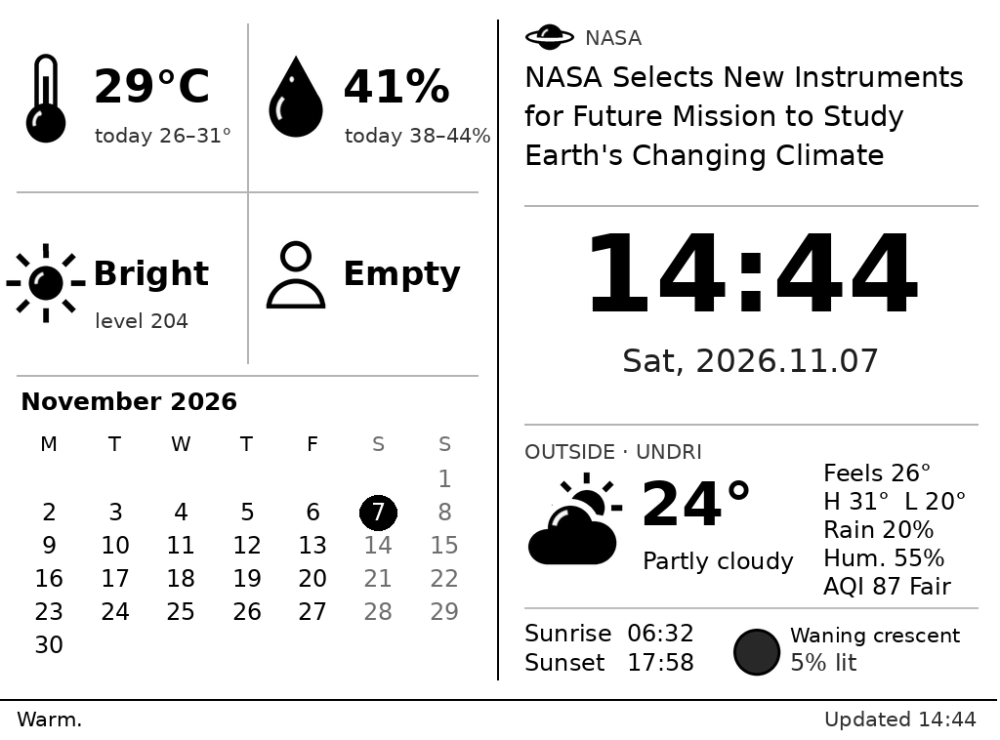
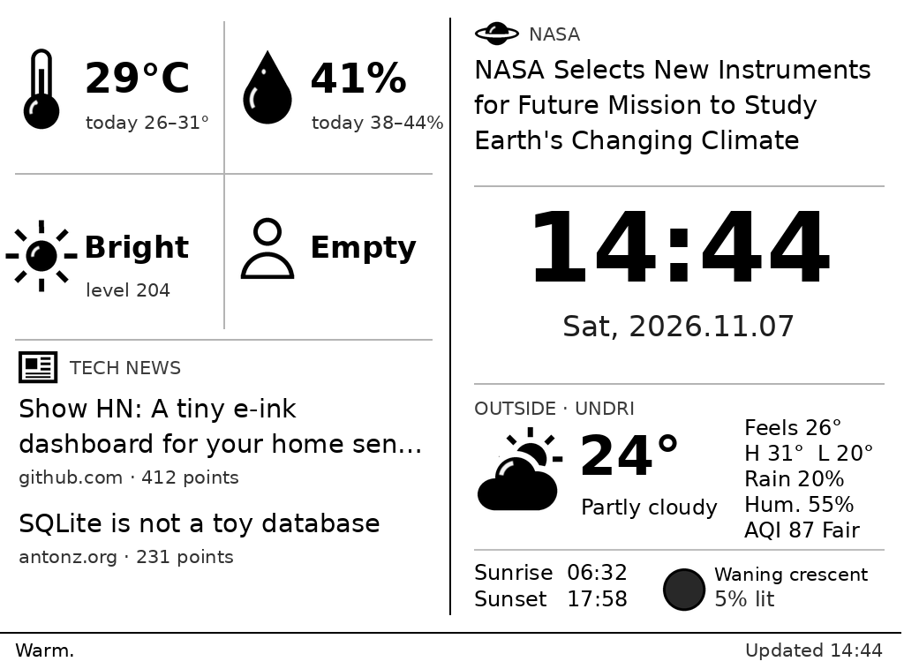
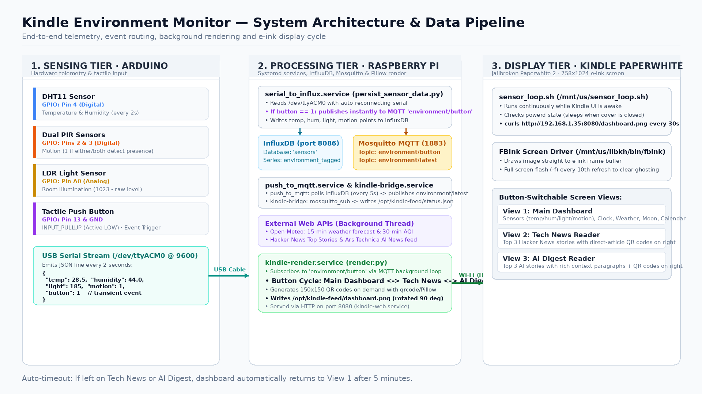
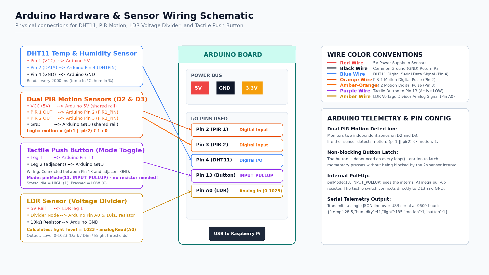

# Kindle Env Monitor

An old Kindle Paperwhite turned into a small e-ink dashboard for my room. It shows readings from my ESP8266 sensor (temperature, humidity, light and motion) along with the time, the weather outside, air quality, the moon phase, a month calendar and a few news headlines.



The bottom-left corner takes turns between the calendar and tech news every few minutes:



## System Architecture



### Hardware & Sensor Wiring



## How it works

The Kindle does almost nothing. It just downloads a picture every 30 seconds and puts it on the screen. All the real work happens on a Raspberry Pi.

1. **Sensing Tier (Arduino)**: Reads the DHT11 (temp/humidity), dual PIR motion sensors (D2 & D3), and LDR (light) every 2 seconds, and listens for tactile button presses on pin 13 (`INPUT_PULLUP`). Emits JSON over USB serial (`/dev/ttyACM0`).
2. **Processing Tier (Raspberry Pi)**:
   - `serial_to_influx`: Reads serial, publishes button presses instantly to MQTT `environment/button`, and logs time-series data to InfluxDB.
   - `push_to_mqtt`: Pulls from InfluxDB every 5s and publishes to MQTT `environment/latest`.
   - `kindle-bridge`: Saves the latest MQTT telemetry to `/opt/kindle-feed/status.json`.
   - `kindle-render`: Background renderer that cycles through three views when the physical button is pressed:
     - **Main Dashboard**: Sensors, clock, weather, moon phase, and calendar.
     - **Tech News Reader**: Top Hacker News stories with scannable QR codes on the right.
     - **AI Digest**: Top AI stories with full context paragraphs from Ars Technica/VentureBeat + QR codes.
   - `kindle-web`: Serves the rendered PNG over HTTP on port 8080.
3. **Display Tier (Kindle)**: A shell loop fetches the image with `curl` and draws it to the e-ink screen using FBInk.

## What's in here

```
arduino/
  sensors_basic_w_btn/
    sensors_basic_w_btn.ino  Arduino sketch reading sensors & debouncing button
kindle/
  sensor_loop.sh     the fetch-and-draw loop
  sensor_start.sh    tap this in the Kindle library to start
  sensor_stop.sh     tap this to stop
pi/
  render.py          draws the dashboard & reader views
  persist_sensor_data.py  reads Arduino serial, publishes button to MQTT, logs to InfluxDB
  systemd/           service definitions
tools/
  preview.py         renders the dashboard locally with sample data
  draw_schematics.py generates the architecture and wiring PNG schematics
docs/                screenshots, schematics and preview images
NOTES.md             where things stand and ideas for later
AGENTS.md            background for coding agents working on this
```

To try layout changes without the Pi or the Kindle, run `python3 tools/preview.py` (it needs Pillow) and open `preview.png`.

## Setting up the Pi

This runs on an older Pi with Raspbian Buster and Python 3.7, so the code avoids newer Pillow features on purpose.

```
sudo apt install -y mosquitto-clients python3-pil fonts-dejavu-core
sudo mkdir -p /opt/kindle-feed/fonts
sudo cp pi/render.py /opt/kindle-feed/
sudo cp pi/systemd/*.service /etc/systemd/system/
sudo systemctl daemon-reload
sudo systemctl enable --now kindle-bridge kindle-web kindle-render
```

You can check that it's working by opening `http://<pi-address>:8080/dashboard.png` in a browser. The image looks sideways because it's drawn for a Kindle lying on its side.

For a rounder look, download Nunito from Google Fonts and copy `Nunito-Bold.ttf` and `Nunito-Regular.ttf` into `/opt/kindle-feed/fonts/`. Without them it falls back to DejaVu Sans.

A few settings at the top of `render.py` are worth knowing about. `LAT`, `LON` and `PLACE` set the location for the weather. `ROTATE` is 90 or 270 depending on which way you hold the Kindle. `NIGHT_FROM` and `NIGHT_TO` set the hours when the screen switches to white on black. `LIGHT_DIM` and `LIGHT_BRIGHT` decide when the light reading counts as dark, dim or bright, and depend entirely on your sensor.

After changing anything, restart the renderer with `sudo systemctl restart kindle-render`.

## Setting up the Kindle

Mine is a Paperwhite 2 (6th gen) on firmware 5.12.2.2, jailbroken with WinterBreak2. On this model the original jailbreak payload runs out of memory, so I used the low-memory fix. The guides at kindlemodding.org cover the jailbreak itself. After the jailbreak, shell integration lets you run `.sh` files straight from the library, and FBInk is already installed.

With the Kindle connected over USB, copy `kindle/sensor_loop.sh` to the top level of the Kindle drive and the start and stop scripts into its `documents` folder. If your Pi isn't at `192.168.1.35`, change the address in `sensor_loop.sh`. Then eject, turn Wi-Fi on, and tap `sensor_start` in the library.

Turn off automatic updates before turning Wi-Fi on, or Amazon may quietly undo the jailbreak.

## Living with it

The Kindle's own interface keeps running underneath, so the power button, the cover and the brightness settings all work as usual. Closing the cover puts it to sleep and the dashboard comes back within 30 seconds of waking it. The trade-off is that the Kindle's clock and Wi-Fi icons sometimes flash up at the top, and a tap on the screen can open whatever book happens to be underneath.

Staying awake with Wi-Fi on drains the battery in a day or two, so mine lives on a small 5 V charger.

To be kind to the screen, the layout shifts by a few pixels every hour, the screen inverts at night, and every tenth refresh is a full flash to clear ghosting.

## Data sources

Weather and air quality come from Open-Meteo, tech headlines from the Hacker News API, and space news from NASA's news release feed. None of them need an API key. The moon phase is calculated locally.
